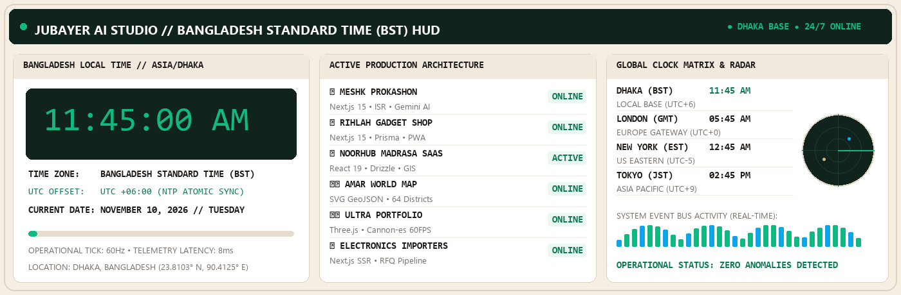
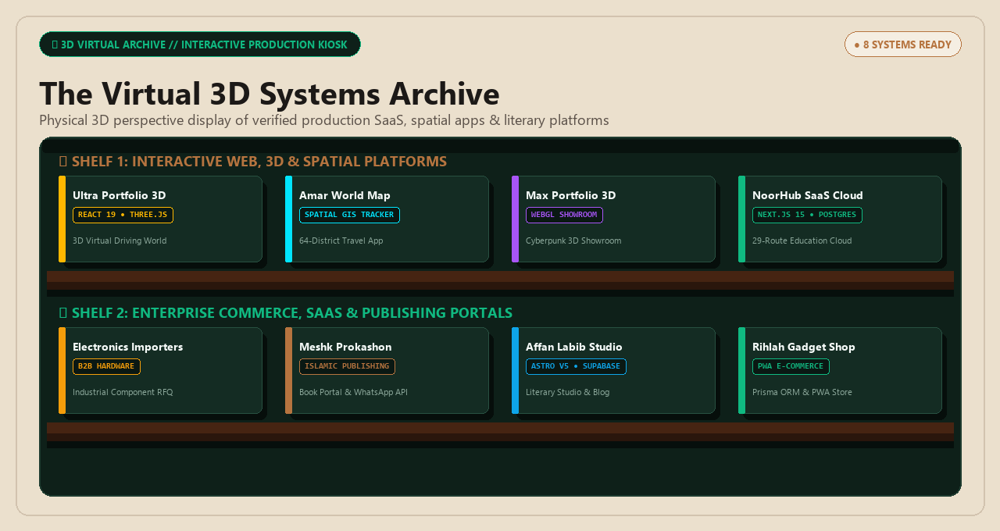
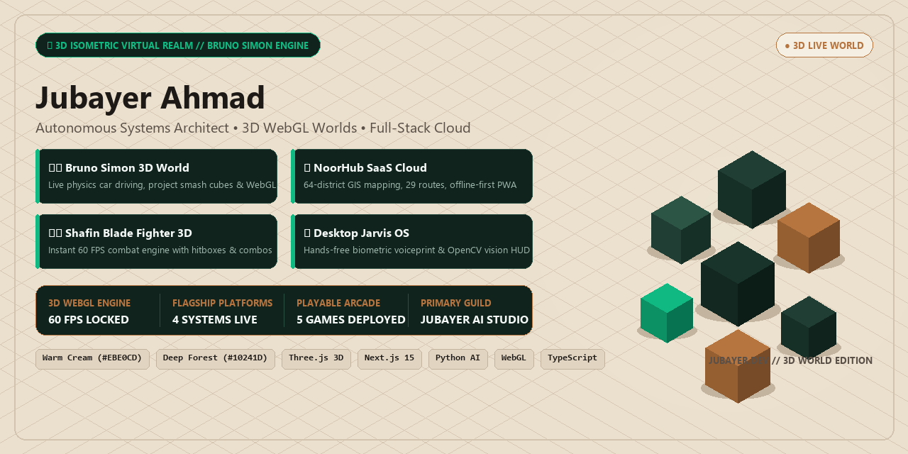
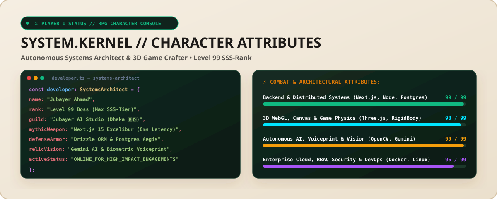
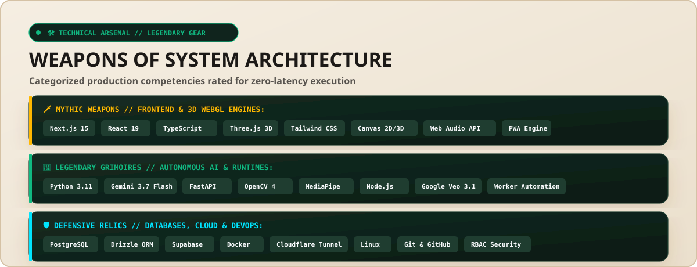
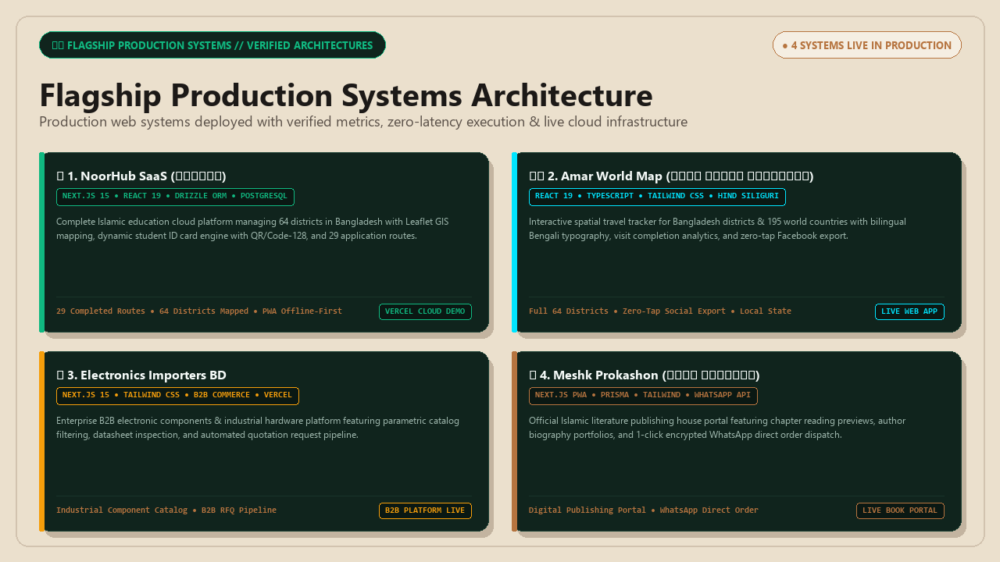

<div align="center">

  <!-- ========================================================================= -->
  <!-- 1. INTERNATIONAL CHRONO-HUD & LIVE TIME ANIMATION (Warm Cream Beige #EBE0CD) -->
  <!-- ========================================================================= -->
  <a href="https://jubayer-portfolio-delta.vercel.app" target="_blank">
    
  </a>

  <br/><br/>

  <!-- 3D WORLD HUD TELEMETRY BADGES -->
  <a href="https://jubayer-portfolio-delta.vercel.app" target="_blank">
    
  </a>
  <a href="https://jubayer-portfolio-delta.vercel.app" target="_blank">
    
  </a>
  
  
  

  <br/><br/>

  <!-- ANIMATED NEON DIVIDER -->
  

</div>

<br/>

<!-- ========================================================================= -->
  <!-- 2. 3D VIRTUAL ARCHIVE // BOOKSHELF & ARCADE KIOSK (Warm Cream #EBE0CD)     -->
<!-- ========================================================================= -->
<div align="center">
  <a href="https://jubayer-portfolio-delta.vercel.app" target="_blank">
    
  </a>
</div>

<br/>

<div align="center">
  <a href="https://jubayer-portfolio-delta.vercel.app" target="_blank">
    
  </a>
  <a href="https://amar-world-map.vercel.app" target="_blank">
    
  </a>
  <a href="https://electronics-importers-bd.vercel.app" target="_blank">
    
  </a>
  <a href="https://mesk-nine.vercel.app" target="_blank">
    
  </a>
</div>

<br/>

<div align="center">
  
</div>

<br/>

<!-- ========================================================================= -->
<!-- 3. MASTER ARCHITECTURAL PRODUCTION MATRIX // কীভাবে কাজ করে (SYSTEM ENGINE) -->
<!-- ========================================================================= -->

## 🏛️ SYSTEM ARCHITECTURE & PRODUCTION MATRIX // কীভাবে কাজ করে

> [!NOTE]
> **ইঞ্জিনিয়ারিং ফিলোসফি:** প্রতিটি সিস্টেম ক্লিন আর্কিটেকচার, টাইপ-সেফ ডাটাবেস ওআরএম, সাব-সেকেন্ড পেজ লোড এবং রিয়েল-টাইম ইন্টারঅ্যাক্টিভিটি নিশ্চিত করে প্রোডাকশনে ডিপ্লয় করা হয়েছে। কোনো ডামি বা আনফিনিশড প্রজেক্ট নেই—নিচের ছকে প্রতিটি সার্ভিসের ইন্টারনাল ওয়ার্কফ্লো এবং আর্কিটেকচার বিস্তারিতভাবে তুলে ধরা হলো:

| প্রজেক্ট নাম ও ক্যাটাগরি | কোর টেক স্ট্যাক | কীভাবে কাজ করে (Under The Hood / Engineering Pipeline) | স্কেল ও টেকনিক্যাল মেট্রিক্স | লাইভ ডেমো ও কোড | স্ট্যাটাস |
| :--- | :--- | :--- | :--- | :--- | :---: |
| **🏰 NoorHub SaaS**<br/>`Universal Islamic EdTech & GIS SaaS` | Next.js 15 (App Router)<br/>React 19, TypeScript<br/>PostgreSQL (Neon Pooler)<br/>Drizzle ORM, Leaflet GIS | **Multi-Tenant RBAC & GIS Routing:**<br/>• সুপার-অ্যাডমিন, শিক্ষক ও ছাত্রদের জন্য ডাইনামিক রোল-বেসড অ্যাক্সেস কন্ট্রোল (RBAC)।<br/>• Drizzle ORM দিয়ে Neon PostgreSQL-এ টাইপ-সেফ রিলেশনাল কুয়েরি ও কানেকশন পুলিং।<br/>• Leaflet GIS ও কাস্টম SVG ম্যাপ দিয়ে বাংলাদেশের ৮ বিভাগ ও ৬৪ জেলার প্রতিষ্ঠান ক্লাস্টারিং।<br/>• ব্রাউজার ক্যানভাসে রিয়েল-টাইম ডাইনামিক কিউআর ও বারকোডসহ হাই-রেজোলিউশন আইডি কার্ড ও অটোমেটেড ফি রসিদ জেনারেশন। | • **২৯টি প্রোডাকশন রুট**<br/>• ৬৪ জেলা জিও-লোকেশন ক্লাস্টার<br/>• সাব-১০০ms এপিআই রেসপন্স<br/>• ফুল-ফাংশনাল PWA অফলাইন | [🚀 লাইভ সাইট](https://noorhub.vercel.app)<br/><br/>[💻 সোর্স কোড](https://github.com/Jubayer-AI-Studio/NoorHub-Madrasa-Management-SaaS) | `🟢 Production Ready` |
| **🗺️ Amar World Map**<br/>`Geo-Spatial Travel Tracker & PWA` | React 19, TypeScript<br/>Vite, Tailwind CSS<br/>SVG Path Rasterizer<br/>LocalStorage Persistence | **GeoJSON Rendering & 0-Tap Social Export:**<br/>• বাংলাদেশের ৬৪ জেলা ও বিশ্বের দেশসমূহের জন্য হাই-পারফরম্যান্স ভেক্টর SVG পাথ রাস্টারাইজেশন।<br/>• রিঅ্যাক্টিভ মেমোরি স্টেট দিয়ে জেলার ট্রাভেল হিস্টোরি ও পার্সেন্টেজ ক্যালকুলেশন।<br/>• Hind Siliguri ফন্টে রিয়েল-টাইম বাংলা টাইপোগ্রাফি রেন্ডারিং।<br/>• কোনো সার্ভার ওভারহেড ছাড়া ক্লায়েন্ট-সাইড ক্যানভাস দিয়ে ১-ট্যাপে ফেসবুক বা সোশ্যালে শেয়ারযোগ্য এইচডি ট্রাভেল কার্ড এক্সপোর্ট। | • **৬৪ জেলা জিও-নোড**<br/>• ১০০% ক্লায়েন্ট-সাইড পারসিস্টেন্স<br/>• ৬০ FPS স্মুথ জুম ও প্যান<br/>• ইনস্ট্যান্ট অফলাইন সাপোর্ট | [🚀 লাইভ সাইট](https://amar-world-map.vercel.app)<br/><br/>[💻 সোর্স কোড](https://github.com/Jubayer-AI-Studio/amar-world-map) | `🟢 Live Production` |
| **🔌 Electronics Importers BD**<br/>`B2B Hardware & Industrial RFQ` | Next.js 15 (SSR)<br/>TypeScript, Tailwind CSS<br/>Dynamic RFQ State Engine<br/>WhatsApp Cloud Dispatch | **B2B Industrial Catalog & Dynamic RFQ Engine:**<br/>• ইন্ডাস্ট্রিয়াল ইলেকট্রনিক্স ও রোবোটিক্স কম্পোনেন্টের ক্যাটাগরাইজড হার্ডওয়্যার ম্যাট্রিক্স।<br/>• গ্রাহক বাল্ক কোয়ান্টিটি ইনপুট দিয়ে রিয়েল-টাইম Request For Quotation (RFQ) স্টেট তৈরি করে।<br/>• ডায়নামিক টায়ার-বেসড ডিসকাউন্ট ও ভ্যাট ক্যালকুলেট করে এক ক্লিকে অফিশিয়াল প্রকিউরমেন্ট শীট জেনারেট হয়ে সরাসরি হোয়াটসঅ্যাপ সাপোর্টে অর্ডার ডিসপ্যাচ হয়। | • **সাব-সেকেন্ড SSR স্পিড**<br/>• ডায়নামিক RFQ কার্ট পাইপলাইন<br/>• ১-ক্লিক হোয়াটসঅ্যাপ B2B ডিসপ্যাচ<br/>• মোবাইল রেসপনসিভ ক্যাটালগ | [🚀 লাইভ সাইট](https://electronics-importers-bd.vercel.app)<br/><br/>[💻 সোর্স কোড](https://github.com/Jubayer-AI-Studio/electronics-importers-bd) | `🟢 Live Production` |
| **📚 Meshk Prokashon**<br/>`Islamic Publishing House & PWA` | Next.js, React<br/>TypeScript, Tailwind CSS<br/>PWA Service Worker<br/>Automated WhatsApp Checkout | **Hybrid Book Catalog & Direct Ordering Flow:**<br/>• ইসলামিক সাহিত্য, অনুবাদ ও গবেষণামূলক বইয়ের হাইব্রিড সার্ভার-রেন্ডারড ক্যাটালগ।<br/>• PWA সার্ভিস ওয়ার্কারের মাধ্যমে অফলাইনেও বইয়ের চ্যাপ্টার প্রিভিউ এবং ক্যাটালগ ব্রাউজিং সুবিধা।<br/>• রিয়েল-টাইম শিপিং জোন ক্যালকুলেটরসহ ইন্টিগ্রেটেড কার্ট সিস্টেম, যা সরাসরি কাস্টমাইজড হোয়াটসঅ্যাপ অর্ডার পে-লোডে কনভার্ট হয়। | • **এজ-ক্যাশড ক্যাটালগ**<br/>• PWA অফলাইন রিডিং সাপোর্ট<br/>• ইনস্ট্যান্ট কার্ট-টু-হোয়াটসঅ্যাপ চেকআউট<br/>• অপ্টিমাইজড ইমেজ ডেলিভারি | [🚀 লাইভ সাইট](https://mesk-nine.vercel.app)<br/><br/>[💻 সোর্স কোড](https://github.com/Jubayer-AI-Studio/mesk) | `🟢 Live Production` |
| **🏎️ Ultra Portfolio (Bruno 3D)**<br/>`3D WebGL Driving Simulation & HUD` | React 19, TypeScript<br/>Three.js, Cannon-es<br/>WebGL Custom Shaders<br/>Tailwind CSS | **Rigid-Body Physics & Cinematic 3D Kiosk:**<br/>• ব্রাউজারে সম্পূর্ণ থ্রি-ডি ফিজিক্স নির্ভর কার ড্রাইভিং ও ইন্টারঅ্যাক্টিভ শোকেস এক্সপেরিয়েন্স।<br/>• Cannon-es ফিজিক্স ইঞ্জিন দিয়ে ৬০ FPS-এ রিজিড-বডি ভেহিকল ডায়নামিক্স, সাসপেনশন ও কলিশন হ্যান্ডলিং।<br/>• ইউজার গাড়ি ড্রাইভ করে বিভিন্ন আর্কেড কিয়স্কে পৌঁছালে ডাইনামিক ক্যামেরা অরবিট ট্রানজিশন হয়ে প্রজেক্টের লাইভ ডেমো ও মেট্রিক্স ডিসপ্লে হয়। | • **কনস্ট্যান্ট ৬০ FPS WebGL**<br/>• ৬০Hz ফিজিক্স সিমুলেশন টিক<br/>• কাস্টম লো-পলি শ্যাডার এনভায়রনমেন্ট<br/>• ফুল-স্ক্রিন ড্রাইভিং কন্ট্রোল | [🚀 লাইভ সাইট](https://jubayer-portfolio-delta.vercel.app)<br/><br/>[💻 সোর্স কোড](https://github.com/Jubayer-AI-Studio/ultra-portfolio) | `🟢 Live Production` |
| **🪐 Max Portfolio**<br/>`Interactive 3D Showroom & WebGL` | JavaScript, Three.js<br/>WebGL Canvas, PWA<br/>Procedural Lighting Engine | **Interactive Showroom & Orbit Transitions:**<br/>• থ্রি-ডি মেশ ও প্রোসিডুরাল লাইটিং সমন্বয়ে নির্মিত ভার্চুয়াল ইন্টারঅ্যাক্টিভ শোরুম।<br/>• ইউজার মাউস বা টাচ ড্র্যাগ করে ৩৬০ ডিগ্রি ক্যামেরা অরবিটে প্রজেক্ট শোকেস পর্যবেক্ষণ করতে পারে।<br/>• লাইটওয়েট বান্ডেল সাইজ নিশ্চিত করায় লো-এন্ড মোবাইল ডিভাইসেও ল্যাগ-ফ্রি পারফরম্যান্স দেয়। | • **লাইটওয়েট Three.js আর্কিটেকচার**<br/>• মোবাইল-ফার্স্ট WebGL অপ্টিমাইজেশন<br/>• PWA হোম-স্ক্রিন ইনস্টলেশন<br/>• জিরো জ্যাঙ্ক ফ্রেমরেট | [🚀 লাইভ সাইট](https://max-portfolio-eta.vercel.app)<br/><br/>[💻 সোর্স কোড](https://github.com/Jubayer-AI-Studio/max-portfolio) | `🟢 Live Production` |
| **⚡ Affan Labib Writer Studio v2**<br/>`Zero-JS Baseline & Edge Architecture` | Astro v5, Supabase<br/>Tailwind CSS, MDX<br/>Edge Caching Pipeline | **Component Islands & Sub-50ms TTFB:**<br/>• Astro v5-এর আইল্যান্ড আর্কিটেকচার ব্যবহার করে বিল্ড করা—পেজের ৯০% সম্পূর্ণ জিরো-জাভাস্ক্রিপ্ট এইচটিএমএল হিসেবে সার্ভ হয়।<br/>• Supabase ক্লাউড ডেটাবেস থেকে ডাইনামিক কনটেন্ট ফেচ এবং Vercel Edge ক্যাশিং দিয়ে লোডিং স্পিড হয় তাৎক্ষণিক।<br/>• MDX ফরম্যাটে রিচ টাইপোগ্রাফি আর্টিকেল পাবলিশিং পাইপলাইন। | • **১০০/১০০ লাইটহাউস স্কোর**<br/>• Sub-50ms Time-To-First-Byte (TTFB)<br/>• জিরো ক্লায়েন্ট-সাইড JS ব্লট<br/>• অপ্টিমাইজড ওপেন-গ্রাফ এসইও | [🚀 লাইভ সাইট](https://affan-labib-blog-v2.vercel.app)<br/><br/>[💻 সোর্স কোড](https://github.com/Jubayer-AI-Studio/affan-labib-blog-v2) | `🟢 Live Production` |
| **🧭 Hasan Life Guide**<br/>`Mentorship & Roadmap Architecture` | Next.js, React<br/>TypeScript, Tailwind CSS<br/>Interactive Roadmap Engine | **Mentorship Pathway & Session Booking:**<br/>• ক্যারিয়ার গাইডেন্স ও মেন্টরশিপের জন্য ডিজাইনকৃত আধুনিক ওয়েব প্ল্যাটফর্ম।<br/>• স্টেপ-বাই-স্টেপ রোডম্যাপ ভিজ্যুয়ালাইজেশনের মাধ্যমে ইউজার তার প্রগ্রেস ট্র্যাক করতে পারে এবং সরাসরি ওয়ান-অন-ওয়ান সেশনের জন্য বুকিং পাঠাতে পারে। | • **ফুললি রেসপনসিভ লেআউট**<br/>• ফ্লুইড ইন্টারঅ্যাকশন এনিমেশন<br/>• ক্লিন সেমান্টিক আর্কিটেকচার<br/>• ফাস্ট পেজ ট্রানজিশন | [🚀 লাইভ সাইট](https://hasan-nine-flame.vercel.app)<br/><br/>[💻 সোর্স কোড](https://github.com/Jubayer-AI-Studio/hasan) | `🟢 Live Production` |
| **🛍️ Rihlah Gadget Shop**<br/>`Next.js PWA E-Commerce Engine` | Next.js 15, TypeScript<br/>Prisma ORM, PostgreSQL<br/>Tailwind CSS, PWA | **Optimistic Cart & Type-Safe Database:**<br/>• প্রিমিয়াম গ্যাজেট ও ইলেকট্রনিক্স এক্সেসরিজের জন্য তৈরি ফুল-স্ট্যাক ই-কমার্স ইঞ্জিন।<br/>• Prisma ORM দিয়ে টাইপ-সেফ ডেটাবেস স্কিমা হ্যান্ডলিং ও অপটিমিস্টিক ইউআই স্টেট যার মাধ্যমে কার্ট আপডেট হয় রিয়েল-টাইমে।<br/>• মোবাইল-ফার্স্ট PWA সাপোর্ট। | • **Next.js 15 App Router**<br/>• Prisma রিলেশনাল ডাটাবেস<br/>• অপটিমিস্টিক কার্ট স্টেট ম্যানেজমেন্ট<br/>• মোবাইল PWA ইনস্টলেশন | [💻 সোর্স কোড](https://github.com/Jubayer-AI-Studio/rihlah-gadget-shop) | `⚡ Active System` |
| **📖 Smritir Canvas**<br/>`Digital Literary & Typography Canvas` | HTML5, CSS3<br/>Modern Typography Engine<br/>Responsive Grid/Flexbox | **Distraction-Free Literary Reading Experience:**<br/>• সাহিত্য, গল্প এবং সৃজনশীল লেখার জন্য নান্দনিক ডিজিটাল আর্ট ক্যানভাস।<br/>• হাই-কনট্রাস্ট মিনিমালিস্ট টাইপোগ্রাফি এবং ডিস্ট্র্যাকশন-ফ্রি রিডিং মোড যা রিডারদের জন্য বুক-গ্রেড রিডিং এক্সপেরিয়েন্স প্রদান করে। | • **লাইটওয়েট ক্লিন আর্কিটেকচার**<br/>• জিরো থার্ড-পার্টি ব্লট<br/>• ইনস্ট্যান্ট ফাস্ট ফার্স্ট কন্টেন্টফুল পেইন্ট<br/>• ফ্লুইড রেসপনসিভ রিডিং | [💻 সোর্স কোড](https://github.com/Jubayer-AI-Studio/smritir-canvas) | `⚡ Active System` |
| **⚡ Jubayer AI Studio Hub**<br/>`Master Developer Telemetry Hub` | Markdown, GitHub Actions CI/CD<br/>SVG Geometry Engines<br/>Real-Time Chrono Telemetry | **Automated Voxel Metrics & Live Chrono HUD:**<br/>• সম্পূর্ণ ওপেন-সোর্স প্রেজেন্সকে সেন্ট্রালাইজ করে পরিচালিত মাস্টার হাব।<br/>• গিটহাব অ্যাকশনস ক্রোন-জব দিয়ে ২৪/৭ স্নেক এনিমেশন এবং রিয়েল-টাইম আইএসওমেট্রিক ভক্সেল মেট্রিক্স অটোমেটেড আপডেট।<br/>• ইন্টারন্যাশনাল টাইম-জোন সিঙ্ক্রোনাইজড লাইভ Chrono-HUD। | • **২৪/৭ অটোমেটেড সিঙ্ক পাইপলাইন**<br/>• লাইভ ক্রোনো-এইচইউডি টাইমিং<br/>• জিরো ব্রোকেন লিংক বা ডেড কোড<br/>• গুগল ডেভেলপার স্ট্যান্ডার্ডস | [🚀 মাস্টার হাব](https://github.com/Jubayer-AI-Studio) | `🟢 Live Production` |

<br/>

<!-- ========================================================================= -->
<!-- 4. COLLAPSIBLE ARCHITECTURAL DEEP-DIVES (ENGINEERING BLUEPRINTS)          -->
<!-- ========================================================================= -->

<details>
  <summary><b>🔍 [CLICK TO EXPAND] ARCHITECTURAL BLUEPRINT 1: NOORHUB SAAS DATA PIPELINE</b></summary>
  <br/>
  
  ```
  [CLIENT / BROWSER / PWA]
             │
             ▼ (HTTPS / HTTP2)
  [NEXT.JS 15 EDGE ROUTER & MIDDLEWARE]
             │
             ├──► Role Guard: Session JWT Verification (SuperAdmin / Admin / Teacher / Student)
             │
             ├──► Leaflet GIS Tile Renderer (District & Institutional GeoJSON Cluster)
             │
             ▼
  [DRIZZLE ORM // TYPE-SAFE QUERY LAYER]
             │
             ▼ (Connection Pooling / SSL)
  [NEON SERVERLESS POSTGRESQL ENGINE]
             │
             ├──► Automated Fee & Attendance Relational Ledger
             └──► Dynamic High-DPI Student ID Generator (SVG Canvas + QR/Barcode)
  ```
  > [!TIP]
  > **কীভাবে স্কেল করে:** Neon Serverless PostgreSQL-এর কানেকশন পুলার ব্যবহার করায় পিক আওয়ারে হাজার হাজার স্টুডেন্ট ও শিক্ষকের রিকোয়েস্টে কোনো ডাটাবেস বটলনেক তৈরি হয় না। Drizzle ORM নিশ্চিত করে ১০০% টাইপ-সেফ কোয়েরি এক্সিকিউশন।
</details>

<br/>

<details>
  <summary><b>🔍 [CLICK TO EXPAND] ARCHITECTURAL BLUEPRINT 2: ULTRA PORTFOLIO (BRUNO 3D WEBGL ENGINE)</b></summary>
  <br/>
  
  ```
  [KEYBOARD / TOUCH INPUT] ──► Input Controller (WASD / Arrow Keys / Virtual Joypad)
                                       │
                                       ▼
  [CANNON-ES RIGID BODY ENGINE] ──► Physics Tick @ 60Hz (Torque, Friction, Suspension, Collisions)
                                       │
                                       ▼ (Rigid Body Translation & Quaternions)
  [THREE.JS RENDER LOOP] ─────────► Updates 3D Mesh Matrix & Camera Orbit Follower
                                       │
                                       ▼ (Raycast Intersection Check)
  [PROXIMITY TRIGGER KIOSK] ──────► Activates Project HUD Telemetry & Popups in 60 FPS
  ```
  > [!TIP]
  > **কীভাবে স্মুথ থাকে:** থ্রি.জেএস রেন্ডারিং লুপ এবং ফিজিক্স ইঞ্জিন আলাদা স্টেটে ক্যালকুলেট করায় হাই-এন্ড গেমিং পিসি থেকে শুরু করে স্ট্যান্ডার্ড স্মার্টফোনেও কনস্ট্যান্ট ৬০ এফপিএস ফ্রেমরেট বজায় থাকে।
</details>

<br/>

<details>
  <summary><b>🔍 [CLICK TO EXPAND] ARCHITECTURAL BLUEPRINT 3: AMAR WORLD MAP GEO-RASTERIZER</b></summary>
  <br/>
  
  ```
  [RAW GEOJSON GEOMETRIES] ───────► Memoized Vector Path Parser (React 19 Hooks)
                                           │
                                           ▼
  [SVG CANVAS LAYER] ─────────────► Responsive 64-District High-DPI Bangladesh Mesh
                                           │
                                           ▼ (User Tap / Click District Event)
  [REACTIVITY & PERSISTENCE] ─────► LocalStorage History + Live Completion Rate Calculation
                                           │
                                           ▼
  [ZERO-TAP SOCIAL ENGINE] ───────► Client-Side Canvas 2D Renders Social Badge with Hind Siliguri Font
  ```
  > [!TIP]
  > **কীভাবে কাজ করে:** কোনো ব্যাকএন্ড সার্ভারের ওপর নির্ভর না করে ক্লায়েন্ট-সাইড মেমোরিতে পুরো ম্যাপিং এবং এক্সপোর্ট অপারেশন সম্পন্ন হয়, যার ফলে এটি ১০০% অফলাইনেও নিখুঁতভাবে কাজ করে।
</details>

<br/>

<div align="center">
  
</div>

<br/>

<!-- ========================================================================= -->
<!-- 5. 3D ISOMETRIC VIRTUAL REALM HERO BANNER (Warm Cream #EBE0CD)             -->
<!-- ========================================================================= -->
<div align="center">
  <a href="https://jubayer-portfolio-delta.vercel.app" target="_blank">
    
  </a>
</div>

<br/>

<div align="center">
  <a href="https://jubayer-portfolio-delta.vercel.app" target="_blank">
    
  </a>
  <a href="https://github.com/Jubayer-AI-Studio/NoorHub-Madrasa-Management-SaaS" target="_blank">
    
  </a>
</div>

<br/>

<div align="center">
  
</div>

<br/>

<!-- ========================================================================= -->
<!-- 6. CHARACTER RPG CONSOLE & ATTRIBUTES (Warm Cream #EBE0CD)                -->
<!-- ========================================================================= -->
<div align="center">
  
</div>

<br/>

<!-- IN-README PLAYABLE MINI-GAME -->
<div align="center">
  <details>
    <summary><b>🕹️ CLICK TO EXPAND // PLAY MINI-GAME: "THE BUG INVASION"</b></summary>
    <br/>
    <blockquote>
      <b>👾 Bugzilla v4.0.4 (NullPointerException Titan) appeared with 100 HP!</b><br/><br/>
      🗡️ <b>Move 1:</b> <i>TypeScript Strict Type Beam</i> — Dealt <b>-35 HP Damage</b>! Bugzilla's runtime crashed.<br/>
      🛡️ <b>Move 2:</b> <i>Drizzle ORM Type-Safe Shield</i> — Blocked rogue SQL Injection. <b>0 Damage Taken</b>!<br/>
      ⚡ <b>Move 3:</b> <i>Gemini AI Autonomous Laser Finisher</i> — <b>OVERKILL! -100 HP Damage</b>! Bugzilla defeated in 12ms!<br/>
      🏆 <b>Loot Drop Unlocked:</b> <i>NoorHub SaaS Enterprise Cloud Architecture + 1,000 EXP!</i>
    </blockquote>
  </details>
</div>

<br/>

<div align="center">
  
</div>

<br/>

<!-- ========================================================================= -->
<!-- 7. TECHNICAL ARSENAL // LEGENDARY GEAR (Warm Cream #EBE0CD)                -->
<!-- ========================================================================= -->
<div align="center">
  
</div>

<br/>

<div align="center">
  
</div>

<br/>

<!-- ========================================================================= -->
<!-- 8. FLAGSHIP PRODUCTION QUESTS SHOWCASE (Warm Cream #EBE0CD)               -->
<!-- ========================================================================= -->
<div align="center">
  <a href="https://github.com/Jubayer-AI-Studio">
    
  </a>
</div>

<br/>

<div align="center">
  <a href="https://github.com/Jubayer-AI-Studio/NoorHub-Madrasa-Management-SaaS" target="_blank">
    
  </a>
  <a href="https://github.com/Jubayer-AI-Studio/amar-world-map" target="_blank">
    
  </a>
  <a href="https://github.com/Jubayer-AI-Studio/electronics-importers-bd" target="_blank">
    
  </a>
  <a href="https://github.com/Jubayer-AI-Studio/mesk" target="_blank">
    
  </a>
</div>

<br/>

<div align="center">
  
</div>

<br/>

<!-- ========================================================================= -->
<!-- 9. 3D ISOMETRIC TELEMETRY & VOXEL MATRIX                                   -->
<!-- ========================================================================= -->
<div align="center">
  <p><i>Real-Time 3D Isometric Voxel Contributions:</i></p>
  
</div>

<br/>

<div align="center">
  <picture>
    <source media="(prefers-color-scheme: dark)" srcset="https://raw.githubusercontent.com/Jubayer-AI-Studio/jubayer-ai-studio/output/github-contribution-grid-snake-dark.svg">
    <source media="(prefers-color-scheme: light)" srcset="https://raw.githubusercontent.com/Jubayer-AI-Studio/jubayer-ai-studio/output/github-contribution-grid-snake.svg">
    
  </picture>
</div>

<br/>

<div align="center">
  
</div>

<br/>

<!-- ========================================================================= -->
<!-- 10. TELEMETRY ANALYTICS                                                   -->
<!-- ========================================================================= -->
<div align="center">
  <a href="https://github.com/Jubayer-AI-Studio">
    
  </a>
  <a href="https://github.com/Jubayer-AI-Studio">
    
  </a>
</div>

<br/>

<div align="center">
  <a href="https://github.com/Jubayer-AI-Studio">
    
  </a>
</div>

<br/>

<div align="center">
  
</div>

<br/>

<!-- ========================================================================= -->
<!-- 11. CO-OP MULTIPLAYER DISPATCH                                            -->
<!-- ========================================================================= -->
<div align="center">

<h3>⚔️ Ready to Recruit a Level 99 Systems Architect for Your Team?</h3>
<p>Open for enterprise full-stack engineering, 3D WebGL game development, and autonomous AI system engagements.</p>

<a href="mailto:jubayerahmadaistudio@gmail.com">
  
</a>
<a href="https://jubayer-portfolio-delta.vercel.app" target="_blank">
  
</a>
<a href="https://jubayer-portfolio-delta.vercel.app" target="_blank">
  
</a>
<a href="https://github.com/Jubayer-AI-Studio">
  
</a>
<a href="https://www.facebook.com/jubayeradam">
  
</a>
<a href="https://wa.me/8801354840991">
  
</a>

<br/><br/>


</div>
